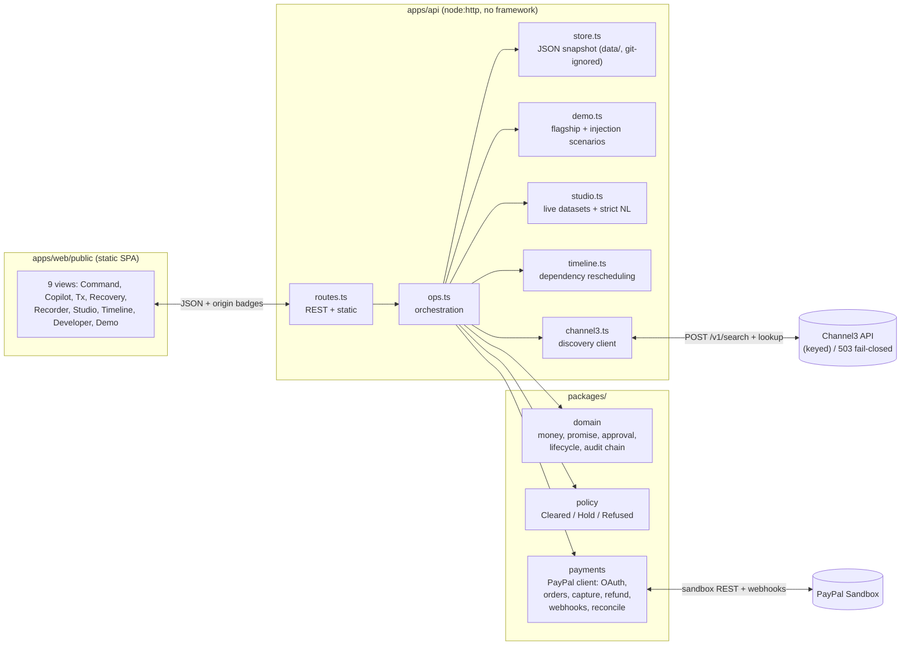

# AFTERPACT — Architecture

Single-process TypeScript app: a zero-dependency Node HTTP API serving a
static single-page UI. Money is exact (integer minor units); every
financial move passes a deterministic policy gate and lands in an
append-only hash-chained audit log. Screenshots: `docs/demo/screenshots/`.

## Request flow (flagship)

1. `POST /api/demo/run {flagship}` (or UI `#/demo`) → `runFlagship` drives
   the same `Ops` methods as the routes (no parallel demo backend).
2. Intent → catalog offer → `PurchasePromise` (versioned, hash-chained) →
   approval bound to version+hash → mock or live-sandbox order/capture.
3. Outcome events → rule-based mismatch detection → incident → templated
   resolution proposal → policy gate → operator approval → refund →
   provider verification → `RESOLUTION_VERIFIED`.
4. Every step appends to the audit chain (`verifyAudit()`); UI badges show
   transport + chain state; judges replay via `#/recorder` and export a
   redacted bundle.

## Trust boundaries

- AI-shaped outputs are Zod-validated proposals only (`domain/ai.ts`);
  `policy` decides, a human approves, `payments` executes.
- Live mode needs `PAYPAL_MODE=live` **and** `PAYPAL_ALLOW_LIVE=true`.
- Kill switch refuses new ops; reads, webhooks, and reconciliation stay open.
- No secrets in repo; status endpoints expose presence booleans only.

## Deploy

`render.yaml` Blueprint (web service + disk) + CI
(`.github/workflows/ci.yml`: install → typecheck → tests → build →
flagship smoke). Postman collection mirrors the same routes.
